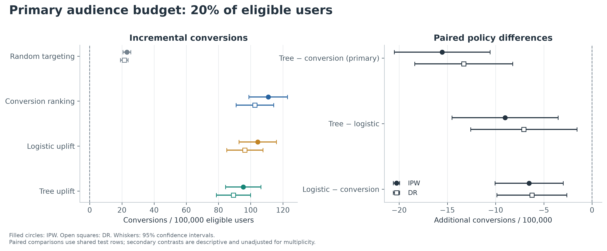

# Causal Targeting: Who Actually Benefits from Advertising?

If you can advertise to only 20% of users, should you choose the people most likely to buy or the people whose purchase decision the ad is most likely to change?

I tested both approaches using **nearly 14 million records from a randomized advertising experiment**. I built a Python and DuckDB SQL pipeline to train the models, select audiences, and estimate how many additional conversions each targeting policy would produce on held-out data.

**At the 20% audience budget, conversion ranking outperformed both uplift models.** The boosted-tree uplift policy produced **15.5 fewer incremental conversions per 100,000 eligible users** than conversion ranking (95% CI 10.6–20.5 fewer). All three models improved on random targeting, but directly estimating treatment effects did not deliver the best policy in this comparison.

[Read the full report](docs/research_report.md) · [See the research plan](docs/research_plan.md) · [Browse the Python package](src/causal_targeting/)



## What I compared

A conversion model finds people likely to buy, including people who would buy without an ad. An uplift model estimates how much assigning someone to treatment changes their probability of buying. With a limited audience budget, the goal is to reach users with the largest incremental benefit.

I compared three ways to rank users, then targeted the top 5%, 10%, 20%, or 50% under each policy.

| Policy | How it selects users |
|---|---|
| Conversion ranking | A boosted model ranks users by their predicted purchase probability under treatment |
| Logistic uplift | A regularized logistic model with treatment interactions ranks users by their estimated treatment effect |
| Tree uplift | Separate boosted models for treated and control users estimate the difference in purchase probabilities, an approach known as a T-learner |

Random targeting and targeting nobody provide the reference points. The primary comparison, fixed before test evaluation, was **tree uplift minus conversion ranking at a 20% audience budget**.

## Results

| Policy at 20% | Incremental conversions [95% CI] | Difference vs random [95% CI] |
|---|---|---|
| Random targeting | 23.1 [20.6, 25.6] | Reference |
| Conversion ranking | 110.9 [98.9, 122.9] | 87.8 [78.2, 97.4] |
| Logistic uplift | 104.4 [92.8, 116.0] | 81.3 [71.9, 90.6] |
| Tree uplift | 95.4 [84.4, 106.4] | 72.2 [63.4, 81.1] |

Values are estimated additional conversions per **100,000 eligible users**, relative to targeting nobody. They use inverse-probability weighting on the held-out test set of **4,193,056 users**. All intervals are pointwise 95% confidence intervals.

The primary difference was **−15.5 [−20.5, −10.6]** for tree uplift versus conversion ranking. Tree uplift also trailed at every other audience budget tested. A doubly robust evaluation gave the same direction at 20%, with a difference of **−13.3 [−18.4, −8.2]**.

The simpler logistic uplift model came closer to conversion ranking, trailing by **6.5 [3.0, 10.1]** conversions per 100,000 users. The conversion model’s ROC-AUC was 0.95, but the targeting decision was evaluated using incremental conversions. This comparison shows why policy value needs to be measured directly, even when the models are designed for causal estimation.

## Data and evaluation

The study uses the corrected **Criteo Uplift Prediction Dataset v2.1**, with 13,979,592 rows and 12 anonymized features measured before treatment. In the source experiment, 85% of users were assigned to the ad-eligible treatment group. The overall conversion rate in the dataset is 0.292%.

| Choice | Approach |
|---|---|
| Data split | A fixed hash-based split assigns 60% of rows to training, 10% to validation, and 30% to testing |
| Model development | Tuning uses 500,000 training and 500,000 validation rows. Final models train on 2 million rows |
| Test set | 4,193,056 rows with 12,300 conversions, held out until model choices were frozen |
| Policy evaluation | Inverse-probability weighting uses the known 85% treatment assignment probability to estimate each policy’s incremental value |
| Comparisons | Paired confidence intervals compare policies using the same test users |
| Robustness | Doubly robust estimates and propensity sensitivity checks accompany the primary analysis |

Assigning everyone to treatment had an estimated average effect of **115.8 [103.5, 128.2]** additional conversions per 100,000 test users, using a difference in means.

The [research plan](docs/research_plan.md) was written before modeling. Model choices were frozen and hashed in `results/freeze.json` before test evaluation, and the models use only features measured before treatment. The test suite checks splitting, leakage, audience budgets, and estimators using synthetic fixtures.

## What the results can tell us

The main comparison supports conversion ranking over the two uplift policies tested on this benchmark. It also shows how difficult treatment-effect estimation can be when conversions are rare. The test set contains only **1,227 control-group conversions**, which limits the precision of uplift estimates.

The dataset is anonymized and resampled, with undisclosed subsampling of rows with negative labels. Absolute effects therefore depend on the benchmark’s sampling, and any financial examples in the report use hypothetical costs. Feature-based propensity checks changed the absolute policy values substantially while preserving the direction of the primary comparison.

The random split evaluates performance within this dataset. Performance on future traffic remains an open question. Confidence intervals assume independent rows and exclude variability from retraining the models. Anonymous features also limit demographic fairness analysis. A deployment decision would require a prospective randomized comparison of policies using actual costs, outcomes, and safeguards.

## Reproduce the analysis

Python 3.12 is recommended. Run the commands below from the repository root. Package installation and the 311 MB dataset download require network access. Allow about 4 GB of disk space and several GB of RAM.

```bash
python3 -m venv .venv
source .venv/bin/activate
python -m pip install -r requirements.lock
python -m pip install --no-deps -e .
python -m pytest -q
python -m causal_targeting run --rebuild
python -m causal_targeting verify
```

The pipeline downloads and verifies the data, ingests it into DuckDB, trains the models, evaluates the policies, and generates the report. To use a local download, add `--data-file /absolute/path/criteo-research-uplift-v2.1.csv.gz` to the run command.

You can also run individual stages with `download`, `prepare`, `develop`, `evaluate`, `report`, and `verify`. The `report` stage regenerates figures and documents, including this README, from saved aggregate results. Running `--rebuild` repeats the fixed analysis on the same test set.

The recorded Apple Silicon run took 41 seconds for model development and 245 seconds for evaluation, plus time for download, ingestion, and figures.

## Repository guide

| Path | Contents |
|---|---|
| [Full report](docs/research_report.md) | Identification assumptions, results, uncertainty, robustness, and business interpretation |
| [Research plan](docs/research_plan.md) | Questions and evaluation choices set before modeling |
| [Data sources](docs/data_sources.md) | Dataset provenance, erratum, papers, license, and checksum |
| [Methodological Q&A](docs/interview_guide.md) | Explanation of the design decisions |
| [Execution log](PROGRESS.md) | Project decisions and run history |
| `src/causal_targeting/` | Models, estimators, command-line interface, and report generation |
| `sql/` | DuckDB ingestion, data checks, balance checks, and analysis queries |
| `tests/` | Tests using synthetic fixtures |
| `results/` | Aggregate tables, figures, and frozen model specifications |

## License and citation

Code is available under the [MIT license](LICENSE). Data-derived tables, figures, and documents follow the [CC BY-NC-SA 4.0 terms described here](DATA_LICENSE.md). Raw data, fitted models, and predictions for individual rows are excluded from the repository.

Please cite Diemert et al. (2018, 2021) using the references in [data sources](docs/data_sources.md). This project is independent of Criteo and implies no endorsement.
