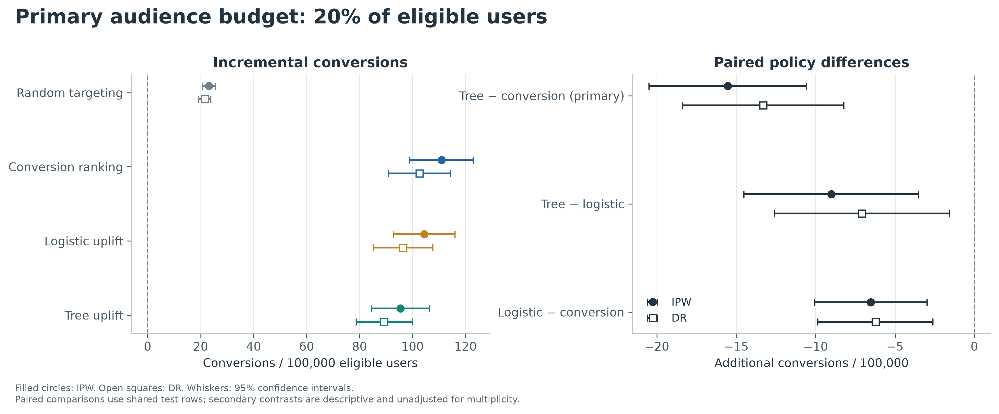

# Causal Targeting: Who Actually Benefits from Advertising?

**Does targeting ads at the people a model predicts will buy, or at the people an ad is predicted to *persuade*, produce more extra conversions?** This project answers that on a large randomized advertising experiment, the corrected Criteo Uplift v2.1 dataset (13,979,592 rows), using Python, DuckDB SQL, logistic regression and gradient-boosted trees.

## Why this question matters

A conversion model ranks users by how likely they are to buy. But many likely buyers would buy without seeing an ad, so showing them one adds little. **Uplift (causal) targeting** instead ranks users by the estimated *increase* in purchase probability caused by the ad. In principle it should spend a limited ad budget better. This project tests whether it does, out of sample, with the analysis plan fixed before seeing any test results.

## Headline result

At the pre-specified budget of reaching 20% of users:

- **Boosted-tree uplift targeting produced fewer extra conversions than plain conversion ranking: -15.5 [-20.5, -10.6] per 100,000 users** (95% CI). The flexible uplift policy underperformed conversion targeting in the prespecified comparison.
- Tree uplift trailed conversion ranking at every audience budget tested (5%, 10%, 20%, 50%), and under doubly robust evaluation (-13.3 [-18.4, -8.2] at 20%).
- The simpler **logistic uplift** model also trailed conversion ranking (-6.5 [-10.1, -3.0]), but outperformed tree uplift (tree minus logistic: -9.0 [-14.5, -3.5]).
- Every model-based policy beat **random targeting** by a wide margin: tree uplift added 72.2 [63.4, 81.1] conversions per 100,000 over random.
- The conversion model predicts buyers very well (ROC AUC 0.95). At this budget, its ranking also captured more incremental conversions than the models built specifically to estimate the ad's effect.

**Takeaway:** a model designed to estimate causal effects is not automatically a better targeting policy. The choice should be made by a randomized comparison of policies, not by model sophistication or predictive accuracy.



## Results at a 20% audience budget

| Policy at 20% | IPW estimate [95% CI] | Difference vs random [95% CI] |
| --- | --- | --- |
| Random targeting | 23.1 [20.6, 25.6] | Reference |
| Conversion ranking | 110.9 [98.9, 122.9] | 87.8 [78.2, 97.4] |
| Logistic uplift | 104.4 [92.8, 116.0] | 81.3 [71.9, 90.6] |
| Tree uplift | 95.4 [84.4, 106.4] | 72.2 [63.4, 81.1] |

Values are incremental conversions per 100,000 eligible users, measured against targeting nobody, on an untouched test set of 4,193,056 rows. Intervals are pointwise 95% confidence intervals. The only pre-specified primary comparison is tree uplift minus conversion ranking at 20%.

## Data

- **Source:** Criteo Uplift Prediction Dataset v2.1 (corrected release), a randomized experiment in which 85% of users were randomly assigned to the ad-eligible treatment group. There are 12 anonymized pre-treatment features, and the conversion rate is 0.292%.
- **Splits:** a fixed, hash-based 60/10/30 train/validation/test split.
  - Final models trained on 2,000,000 rows; tuning used 500,000 training and 500,000 validation rows.
  - The test set (4,193,056 rows, 12,300 conversions) was held out until model choices were frozen.
- **Average effect of the ads in the test set:** 115.8 [103.5, 128.2] extra conversions per 100,000 users (difference in means).

## Method

1. **Three targeting policies:**
   - Conversion ranking (boosted model of purchase probability under treatment)
   - Logistic uplift (regularized logistic regression with treatment interactions)
   - Tree uplift (boosted-tree T-learner: separate treated and control models, ranked by their difference)
2. **Budgets:** each policy targets the top 5%, 10%, 20% or 50% of users. Random targeting and targeting nobody are the reference points.
3. **Evaluation:** because treatment was randomized with a known 85% probability, each policy's value is estimated by inverse-probability weighting (IPW) on held-out data. Doubly robust estimates and propensity sensitivity checks are reported alongside.
4. **Discipline:**
   - The [research plan](docs/research_plan.md) was written before modeling.
   - Model choices are frozen and hashed in `results/freeze.json` before test evaluation.
   - Only pre-treatment features enter the models.
   - Paired confidence intervals compare policies on the same test users.

## Reproduce

Python 3.12 recommended; run from the repository root. Network access is needed for packages and the 311 MB publisher-hosted dataset. Allow about 4 GB of disk and several GB of RAM. Recorded run time on Apple Silicon was 41 s for model development and 245 s for evaluation, plus download, ingestion and figures.

```bash
python3 -m venv .venv
source .venv/bin/activate
python -m pip install -r requirements.lock
python -m pip install --no-deps -e .
python -m pytest -q
python -m causal_targeting run --rebuild     # download, verify checksum, ingest, train, evaluate, report
python -m causal_targeting verify            # check results and documents agree
```

To use an already-downloaded file, add `--data-file /absolute/path/criteo-research-uplift-v2.1.csv.gz`.

**Individual stages:** `download`, `prepare`, `develop`, `evaluate`, `report`, `verify`. `report` regenerates figures and documents (including this README) from saved aggregate results. `--rebuild` repeats the fixed plan on the same test set, so it is a reproduction, not a new experiment.

## Repository guide

| Path | Contents |
|---|---|
| [docs/research_report.md](docs/research_report.md) | Full write-up: identification, results, uncertainty, robustness, business interpretation |
| [docs/interview_guide.md](docs/interview_guide.md) | Concise defense of each design decision |
| [docs/resume_bullets.md](docs/resume_bullets.md) | Résumé bullets grounded in the results |
| [docs/data_sources.md](docs/data_sources.md) | Dataset provenance, erratum, papers, license, checksum |
| [PROGRESS.md](PROGRESS.md) | Decisions and execution log |
| `sql/` | DuckDB ingestion, analysis table, data quality, balance and score-decile queries |
| `src/causal_targeting/` | Models, estimators, CLI and generated reporting |
| `tests/` | Split, leakage, budget and estimator tests (synthetic fixtures) |
| `results/` | Machine-readable tables, figures (PNG/SVG/PDF), frozen plan hashes |

## Limitations

- **Benchmark, not a business.**
  - The dataset is resampled and anonymized, with undisclosed subsampling of negative-label rows, so effects do not translate to a real advertiser's population or ROI.
  - Any economics shown in the report are labeled hypothetical.
- **No time or cluster structure.**
  - Random splits do not test performance on future traffic.
  - Intervals assume independent rows, and exclude retraining variability.
- **Rare outcomes.** Only 1,227 control-group conversions in the test set limit precision for uplift estimates.
- **Sensitivity.** Feature-based propensity checks move the absolute policy values substantially while preserving the direction of the main comparison.
- **No fairness claims.** Anonymous features do not support demographic fairness conclusions.
- **Deployment would require** a prospective randomized test of competing policies with real costs, outcomes and safeguards.

## License and citation

- **Code:** [MIT](LICENSE).
- **Data-derived tables, figures and documents:** [CC BY-NC-SA 4.0](DATA_LICENSE.md), following the Criteo dataset license.
- **Raw data:** raw data, fitted models and row-level predictions are not included.
- **Citation:** please cite Diemert et al. (2018, 2021) as listed in [data sources](docs/data_sources.md). No Criteo endorsement is implied.
