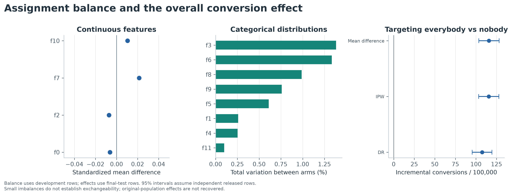
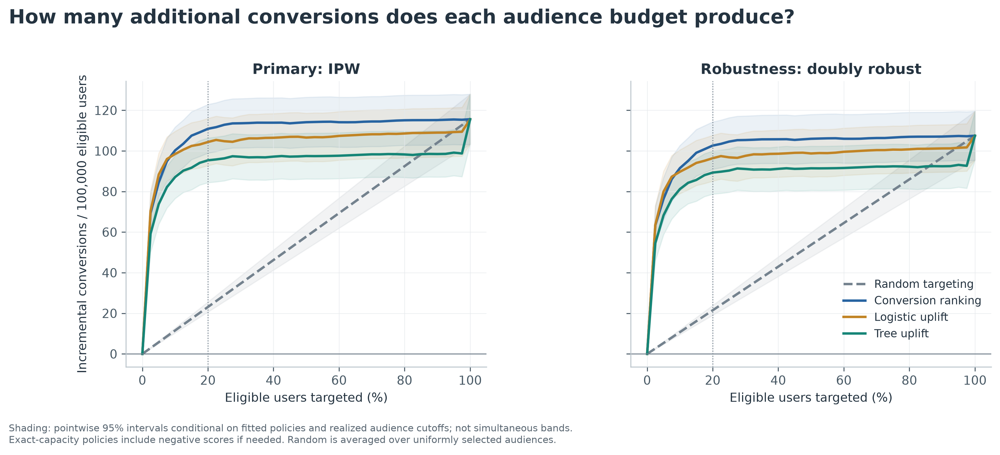
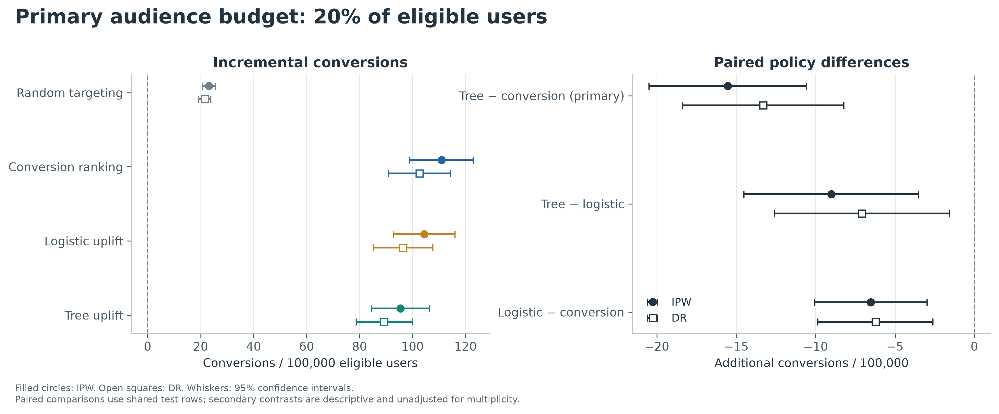
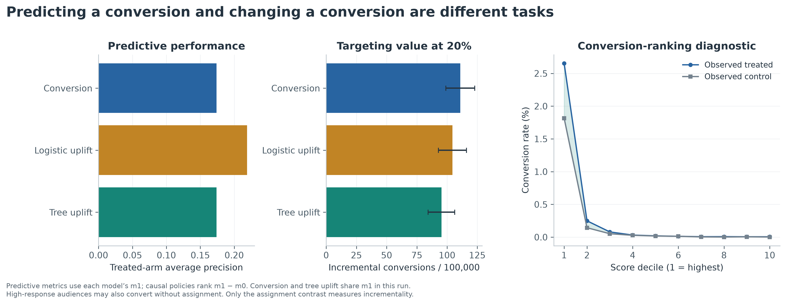
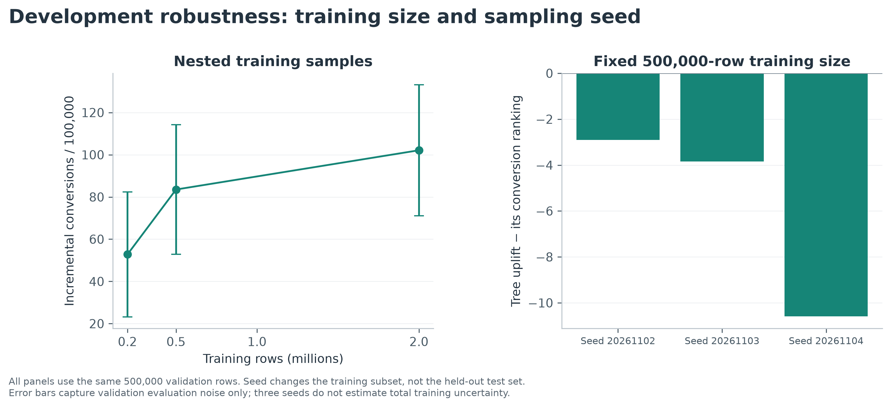

# Causal Targeting: Who Actually Benefits from Advertising?

## Finding and decision

At 20% capacity, tree uplift targeting achieved 95.4 [84.4, 106.4] incremental conversions per 100,000 eligible benchmark users. Its paired advantage over conversion ranking was **-15.5 [-20.5, -10.6]**, versus -13.3 [-18.4, -8.2] with doubly robust evaluation. The flexible uplift policy underperformed conversion targeting in the prespecified comparison.

Its difference from the interpretable logistic uplift policy was -9.0 [-14.5, -3.5]. These comparisons do not justify choosing a model by predictive accuracy alone, and they do not establish a universal advantage for a model family. The practical next step is a prospective randomized comparison of candidate targeting policies with business-specific outcomes and costs, rather than deployment based on one offline benchmark.

## Dataset and estimand

We verified the corrected 13,979,592-row file against Criteo's pinned publisher repository SHA-256, schema and erratum. The old download endpoint was unavailable; provenance, exact URL, license and source citations are in [data_sources.md](data_sources.md) and [the manifest](../results/data_manifest.json). No synthetic observations enter the empirical analysis.

The unit is a released record, described as a browser user in an advertiser experiment. Treatment means assignment to advertising eligibility; exposure is a downstream event, not the intervention used here. The primary outcome is conversion; visits are secondary. Only f0–f11 are covariates. Anonymous feature tokens have no inferred business meaning.

For an audience rule pi(X), the target is

```
V(pi) = E[pi(X) * (Y(1) - Y(0))].
```

This is incremental value relative to nobody being assigned advertising. Total conversions under a policy instead equal E[Y(0)] + V(pi). Conversions observed only among selected treated users also contain purchases that would occur without assignment, and cannot identify V. For a random audience of fraction q, expected incremental value is q times ATE.

The corrected-release paper supports common-ratio treatment allocation at 0.85, because experiments were resampled to remove advertiser-related assignment leakage. It does **not** disclose the label-sampling probabilities. Identification for the released benchmark therefore assumes retained-sample exchangeability, consistency, positivity and no interference. Without those assumptions, these are evaluations of a standardized released-data contrast, E[pi(X)(E[Y|T=1,X]−E[Y|T=0,X])], rather than a recovered population causal effect. DR does not repair unknown sampling or hidden confounding. Neither insignificant balance diagnostics nor a chance-level classifier proves the design.

## Experimental description

Full-release summaries (computed mechanically after model freeze for reporting):

| Assignment | Rows | Conversions | Conversion rate | Visit rate | Exposure rate |
| --- | --- | --- | --- | --- | --- |
| Control | 2,096,937 | 4,063 | 0.1938% | 3.820% | 0.000% |
| Treatment | 11,882,655 | 36,711 | 0.3089% | 4.854% | 3.604% |

No values were missing/nonfinite; all four indicators were binary. No control row had exposure and no conversion lacked a visit. Development-only conversion ATE was 114.9 [106.9, 123.0]; the untouched-test difference-in-means ATE was 115.8 [103.5, 128.2], both per 100,000. Conversion is rare, and only 1,227 positive control outcomes are available in the full test set. A small selected audience has fewer still; see `audience_diagnostics.csv` for exact counts. Normal intervals are approximate; they should not be extrapolated to tiny segments.



Balance uses standardized mean differences for continuous features and total variation distance for categorical distributions. Categorical numeric SMDs are retained only as mechanical summaries, not interpreted as distances between ordered feature values. Quantiles use DuckDB's bounded-memory approximation. The assignment classifier's validation AUC was 0.5036; its log loss 0.42215 was compared with 0.42131 for constant 0.85. These are diagnostics, not a recovered randomization audit.

## Splits and models

Deterministic label-blind hashes created 8,389,226 train-pool, 1,397,310 validation-pool and 4,193,056 test rows. We used nested train samples of 200,000, 500,000, and 2,000,000; validation tuning used 500,000 hash-selected rows. Remaining development rows contributed descriptive balance/allocation summaries, not model training or tuning. All test rows were evaluated. Source row positions provide reproducibility only; no genuine user, advertiser, experiment, or timestamp key is available. Repeated users across advertisers and dependencies cannot be identified or ruled out.

1. **Conversion ranking:** fit a boosted classifier in T=1; rank m1(X).
2. **Logistic uplift:** fit a regularized logistic model with baseline covariates, assignment and every covariate-by-assignment interaction; score sigmoid(eta(X,1))−sigmoid(eta(X,0)). Coefficients describe anonymous log-odds terms, not direct probability effects.
3. **Tree uplift:** fit separate boosted classifiers in T=0 and T=1; score m1(X)−m0(X).

The logistic model scales continuous inputs and one-hot encodes up to 128 categories per categorical feature. The trees use native categorical splits after retaining the 254 most frequent training categories plus an other category. Pooling is a resource/variance tradeoff that can discard useful rare categories. Unseen categories map to other. Preprocessing is fit exclusively on the training subset. No class weighting or outcome oversampling distorts the probability scale.

We evaluated two tree settings and C in {0.1, 1.0} for logistic regression. Causal settings were chosen by validation IPW value at 20%; the conversion setting by treated-arm validation log loss. Validation policy values are noisy, so selection optimism is expected and addressed by final holdout. Final choices: tree {'max_leaf_nodes': 15, 'max_iter': 100, 'learning_rate': 0.08, 'min_samples_leaf': 150, 'l2_regularization': 10.0}; logistic C=0.1. The same tree setting won both selections, so the conversion model and T-learner share m1, isolating their ranking-score difference. Logistic optimization terminated in 137 iterations out of the 300 cap. No optional causal forest, neural network or DR learner was added; DR here is an evaluator.

## Policies and estimation

The 5%, 10%, 20% and 50% budgets were fixed in advance. Exact-capacity policies select floor(q*n) users by descending score, with independent deterministic hash keys and row ordinal for ties. Negative estimates remain eligible when capacity must be filled. This is a batch allocation rule; score cutoffs adapt to the batch's pretreatment features, never outcomes. Random is integrated over all uniform fixed-size audiences, represented by constant selection probabilities floor(q*n)/n. It avoids adding lottery noise and uses the same expected budget. No-targeting has exactly zero incremental value and zero interval width by definition.

With e=0.85, the primary score and independent-training DR check are:

```
psi_IPW = T*Y/e - (1-T)*Y/(1-e)
psi_DR  = m1(X)-m0(X) + T*(Y-m1(X))/e - (1-T)*(Y-m0(X))/(1-e)
V_hat(pi) = mean(pi * psi)
Delta_hat = mean((pi_A - pi_B) * psi)
SE(Delta_hat) = sd((pi_A - pi_B) * psi, ddof=1) / sqrt(n)
```

Outcome nuisances are the final T-learner fit only on training rows. No test cross-fitting is necessary because fitting and evaluation are separate. The 95% intervals use ±1.96 SE and preserve pairing; subtracting separate CI endpoints would be wrong. They condition on fitted models and realized label-blind audience cutoffs and do not include model selection, training variation, cutoff-estimation variation, clustering or transport uncertainty. The independent-row score method is an approximation to the benchmark experiment. No experiment IDs exist to support cluster-robust inference; uncertainty could be understated if residual dependence is material. Curves have pointwise, not simultaneous, bands. Only the prespecified primary contrast is treated as confirmatory; all other contrasts are descriptive without multiplicity correction.

## Held-out results

| Policy | IPW | Doubly robust |
| --- | --- | --- |
| Random targeting | 23.1 [20.6, 25.6] | 21.5 [19.1, 23.9] |
| Conversion ranking | 110.9 [98.9, 122.9] | 102.6 [91.0, 114.3] |
| Logistic uplift | 104.4 [92.8, 116.0] | 96.4 [85.1, 107.7] |
| Tree uplift | 95.4 [84.4, 106.4] | 89.3 [78.7, 99.9] |





All numbers use per-100,000 eligible users, not per-100,000 targets. The tree versus random contrast was 72.2 [63.4, 81.1]. At 20%, multiply a selected-population treatment effect by 0.20 to obtain the eligible-population value; failing to do so would overstate reach-adjusted impact fivefold.

## Prediction diagnostic

| Model / treated outcome predictions | ROC AUC | Average precision | Log loss |
| --- | --- | --- | --- |
| conversion | 0.952 | 0.1741 | 0.01354 |
| logistic | 0.957 | 0.2189 | 0.01256 |
| tree | 0.952 | 0.1741 | 0.01354 |

Average precision is useful with this low outcome prevalence, but it rewards identifying outcomes under treatment, not incremental outcomes. The conversion model can correctly rank likely buyers who would also buy without advertising. The score-decile plot places treated and control conversion rates beside one another: their difference, not the treated curve alone, supplies assignment-effect evidence. Because individual effects are unobserved, there is no individual-effect RMSE or claim of verified personal benefit.



## Focused robustness

At 500,000 training rows, three independently hash-selected training subsets gave validation tree-policy values from 80.4 to 88.0 per 100,000; paired differences from their own conversion rankings ranged from -10.6 to -2.9. These samples overlap; this is a limited stability diagnostic, not three independent replications. Larger training samples and the simple/flexible comparison are shown below. All stability checks stay in development data.



The empirical development treatment allocation was 0.85006053, versus nominal 0.85. A separate feature-based assignment model was fit on development data and used only as a sensitivity check, clipped to [0.05,0.95] (2531 test predictions clipped):

| Estimator | Tree minus conversion [95% CI] |
| --- | --- |
| IPW | -15.5 [-20.5, -10.6] |
| DR | -13.3 [-18.4, -8.2] |
| IPW_empirical_e | -15.5 [-20.5, -10.5] |
| DR_feature_e | -17.5 [-23.5, -11.5] |

The empirical-propensity intervals condition on that estimated nuisance; they omit its estimation uncertainty. The feature-propensity result also depends on its model. Absolute values are materially sensitive: tree uplift changes from 89.3 [78.7, 99.9] under constant-propensity DR to 56.2 [42.6, 69.8] under feature-propensity DR; conversion ranking changes from 102.6 [91.0, 114.3] to 73.7 [59.0, 88.5]. The assignment model did not improve validation log loss over the constant benchmark, so it is not an established replacement for the documented design probability. Its extreme predictions can nevertheless alter weighted residuals. The primary difference remains negative. This supports the relative comparison more strongly than a precise absolute-effect magnitude. These checks cannot undo unknown label sampling.

Up-to-budget policies require positive estimated uplift as well as being in the top budget:

| Policy | Actual positive-score fraction | Incremental conversions [95% CI] |
| --- | --- | --- |
| Logistic uplift | 20.00% | 104.4 [92.8, 116.0] |
| Tree uplift | 20.00% | 95.4 [84.4, 106.4] |

They can spend less than the exact-capacity policy. A zero estimated effect threshold is a model decision, not proof that all omitted users have nonpositive causal effects.

Secondary visits use the **same conversion-trained policies**, with no separate visit tuning:

| Frozen conversion policy | Incremental visits / 100,000 [95% CI] |
| --- | --- |
| Random targeting | 206.1 [195.4, 216.8] |
| Conversion ranking | 947.2 [896.6, 997.8] |
| Logistic uplift | 935.4 [886.0, 984.7] |
| Tree uplift | 874.3 [827.0, 921.6] |

Visit improvements cannot replace the primary conversion result. They answer a different business question.

## Secondary curve summaries and business sensitivity

We define AUUC = integral_0^1 V(q)dq and Qini area = integral_0^1 [V(q)−q V(1)]dq. Every empirical prefix is integrated by trapezoids, with deterministic tie breaking. `uplift_metrics.csv` contains probability units and values multiplied by 100,000. There is no oracle/perfect-model normalization and these numbers need not match packages with differently normalized Qini coefficients. They are secondary descriptive summaries with no significance ranking.

`hypothetical_economics.csv` assumes values of $10/$50/$100 per incremental conversion and costs of $0.01/$0.05/$0.10 per assignment: net value = value_per_conversion*V − cost_per_assignment*q. These are illustrative dollars, not measured revenue, actual spend or advertiser ROI. Equal-budget costs cancel in pairwise value differences. Assignment is not an impression, so this is a stylized cost model; actual billing may differ.

## What can be defended

The executed analysis supports an out-of-sample comparison of fixed assignment-targeting policies on this corrected benchmark, under the stated sampling and independence assumptions. It does not identify original customer-population ROI, effects for particular users, fair treatment across demographics, later-time performance or cluster-robust precision. A prospective experiment should randomize eligible users among the proposed policy and the best practical comparator at equal capacity, define actual cost/profit and guardrail outcomes, preserve assignment logging and holdout integrity, and estimate uncertainty at the real randomization unit.

The repository includes deterministic ingestion, substantive SQL, frozen metadata, machine-readable tables, vector figures, dependency pins and targeted tests. See the README for exact commands and the interview guide for a concise defense of the design.
